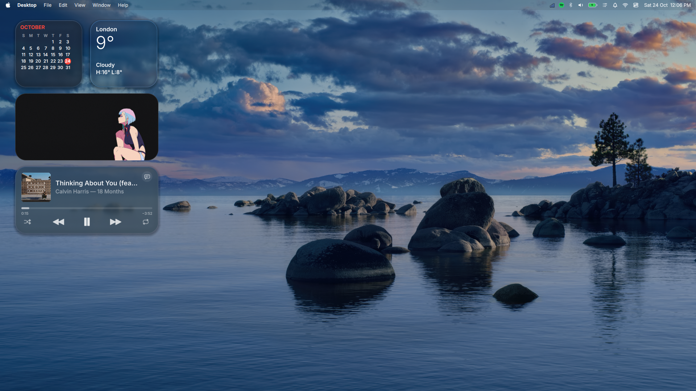

<div align="centre">

## Blackwell

_A minimal setup focused on a balance of performance, aesthetics, productivity and a niche balance of keyboard and mouse driven workflows_

</div>

<p align="centre">

</p>

## TL;DR

- Arch + Hyprland (lua config)+ CachyOS kernel + Limine bootloader

- Nvim using Lazyvim as its "flavour"

- Waybar/Top bar (Quickshell)- Mac-OS like on with the file, edit, view etc stuff you see on and actual Mac,
  and yes, it also 'adapts' to what window your focused on

- Shell - zsh + starship

- Reminders — `ALT + R` opens a Liquid Glass reminder popover (name + duration or clock time, AM/PM or 24-hour), with a menu-bar icon, Control Center tile, due alerts (snooze / done) and a Settings → Reminders pane. Saved to `~/.config/macbar/reminders.json`. Future reminders survive reboot; overdue unacknowledged ones re-alert once after login.
- Lock-screen notifications — MacLock mirrors the latest notifications as normal glass cards (app, icon, time; previews stay hidden like macOS) and shows the next reminder as a live countdown, with Snooze / Done actions when one is due.

- Btfs file system

- For your Wallpapers, drag and drop them into the `~/Pictures/` dir and you can use the wallpaper picker to set it as your wallpaper

- Custom sciprts - they power the waybar design, aesthetic and other stuff

- Symlinks for direct and back-to-back reflection(s) if you want to change stuff.

## Installation

```bash
git clone git@github.com:luvhendrixx/Sur.git ~/dotfiles
cd ~/dotfiles
chmod +x install.sh
./install.sh
```

This, just to name a few...

- Installs pkgs
- Links every config
- setups up stuff like keyd and so on
- auto-detects your ESP mnt pint and root UUID, sets up the bootloader, registers it in firmware and generates a boot entry for the installed kernel
- follow the small instructions once its done

From there **Reboot** and you ought to be good to go.

## Keymap (The Essentials)

| Keys                                  | Action                                           |
| ------------------------------------- | ------------------------------------------------ |
| `SUPER + T` / `SUPER + Return/Enter`  | Terminal (Kitty)                                 |
| `SUPER + Q` / `SUPER + W`             | Close window                                     |
| `SUPER + E` / `SUPER + SHIFT + F`     | Files (Nautilus)                                 |
| `SUPER + B`                           | Browser (Firefox/Zen)                            |
| `SUPER + Space`                       | App launcher (rofi)                              |
| `SUPER + D`                           | Wallpaper picker                                 |
| `SUPER + S` / `SUPER + ALT + S`       | Scratchpad toggle / send window                  |
| `SUPER + ,`                           | Dismiss last notification                        |
| `SUPER + .`                           | Emoji picker (copies directly to focused window) |
| `SUPER + C` / `SUPER + V`             | Universal copy / paste                           |
| `SUPER + I`                           | Settings                                         |
| `SUPER + N`                           | Notifications                                    |
| `ALT + R`                             | Reminders (view / add / snooze)                  |
| `SUPER + F`                           | Fullscreen                                       |
| `SUPER + O`                           | Opacity                                          |
| `SUPER + H J K L` / arrows            | Focus window                                     |
| `SUPER + SHIFT + H J K L` / arrows    | Move window                                      |
| `SUPER + CTRL + H J K L`              | Resize window                                    |
| `SUPER + 1…0` / `SUPER + SHIFT + 1…0` | Switch / move to workspace                       |
| `SUPER + /` / `SUPER + ALT + /`       | Zoom in / out                                    |
| `SUPER + SHIFT + X`                   | Quickshell wheel launcher                        |
| `SUPER + SHIFT + E`                   | Exit session                                     |
| `SUPER + L`                           | Lock screen (MacLock)                            |
| `SUPER + SHIFT + GRAVE(backtick)`     | Power menu                                       |
| `PRINT`                               | screenshot overlay                               |
| `Volume / Brightness keys`            | wpctl / brightnessctl (+ OSD)                    |
| `SUPER + ALT + L`                     | 43PR engine for light/dark toggles               |
| `SUPER + D`                           | Toggle wallpaper picker                          |

Althogh you can click on the **help** button on the waybar to pull up the full cheetsheet

## BTW

Rule of thumb:

If it's a symlink, **touch at your own risk**

So...

> **DO NOT TRY TO DELETE, MOVE OR HIDE** the `~/dotfiles` directory after installation!!

you'll **break symlinks** and well...trust, its not fun at all setting up your system from scratch

## Updates

As an addon, it has its own script, **bw** (Blackwell) that does stuff (see below).

```bash
Usage:
bw {flag}

Flags:
-u, --update Full suite (yay + fetch)

-f, --fetch Dotfiles fetch only

-F, --firmware Firmware (LVFS/fwupd) update check: refresh metadata, list updates, ask before installing

-p, --pull Dotfiles pull only

-y, --yay yay/AUR updates only

-s, --status Show repo status (branch, ahead/behind etc)

-d, --diff Dry run: commits/patch that would come in from the pull

-l, --log Show last 5 local & remote commits

-h, --help show this help your reading right now
```

```bash
Examples:

bw -u

bw update

bw -s

bw -F
```

### Firmware updates

The setup also keeps an eye on firmware (BIOS/SSD/dock updates from LVFS) so
it never silently rots behind your package upgrades:

- a **pacman hook** (`95-fwupd-check.hook`, installed by `install.sh`) runs after
  every `sudo pacman -Syu` / `bw -u` transaction, tells you right in the
  terminal (and with a desktop notification) if firmware updates exist —
  it **never installs anything**, it only reports;
- `fwupd-refresh.timer` keeps LVFS metadata fresh in the background;
- `bw -F` is the manual lever: refresh, show what's available, and only
  install when you answer `y`. Firmware updates often want a reboot and a
  decent battery, so the choice stays yours.

Read-only by design: `sudo pacman -Syu && ...` stays a normal upgrade flow,
whether or not there's a firmware update waiting.

Other useful flags:

`./install.sh --dry-run` (preview changes),

`./install.sh --link-only` (do symlinks only).

## All hell broke loose!?

Probably relax, the setup includes a pretty neat **limine x btrfs x snapper x pacman hook** 'pipeline' that takes a snapshot of your system on every update you make

So if something breaks, reboot and choose one of the snapshots

It's also 'reasonably' configured in that the snapshots don't "hog" your storage, tho you can use the **btrfs assistant** app that ought to be downloaded for a 'less scary' config incase you want to tweak stuff to your preferences

## Extras

This setup is based off
[43PR's dots](https://github.com/43PR/dotfiles) and [O-ss](https://github.com/0-ss/MacShell) on Github. And thank you to both for the incredible and easy to use setup and xp
